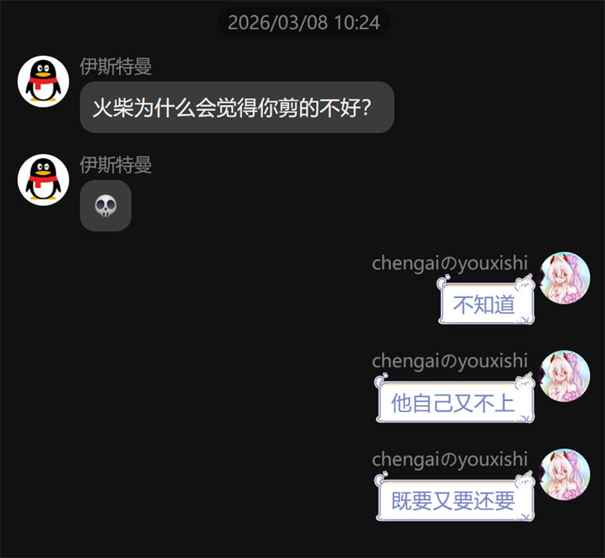
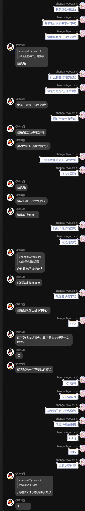
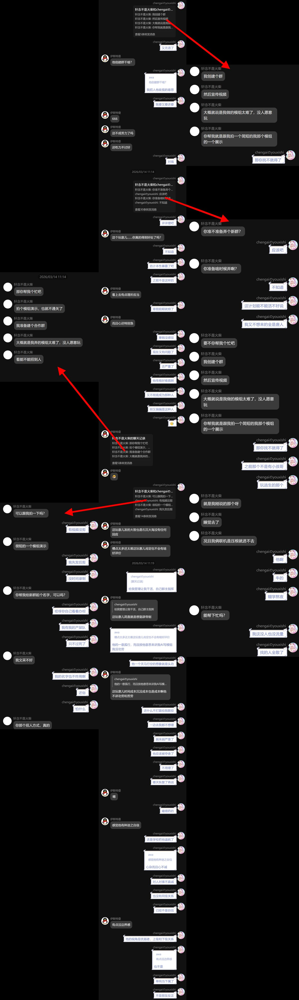

**朋友**，这词何其飘渺，又何其深重。

**轩念**是我阳历2026年底差不多认识的，说实话这人我挺喜欢的，有很多优点。其一，他**心放很大**，一般不闹小脾气，开开心心、和和气气，至少我是没看见他正面性和谁冲突。也许他难受不会往心里搁，也许他就不曾难受过，给我形象是**阳光积极**的男孩，我冷漠他他也似乎平常。这与我的待人情况差不多，别人若嫌我，我便不深交，他人若冷漠我，我便同样冷漠他。

一开始我和轩念的话还是很多的，聊聊这个啊，聊聊那个啊。之前是私聊聊的起劲，他是住宿生，每周回来一次，回来后就讨论录视频的事情，**聊一会录一会，然后发视频**，这种工作模式没什么不好的。

并且他把他在别的大群里认识的一人拉过来了——**宇宙**。我这边又有一位主动找我合作的人——**没问题**。于是乎四个人就组团建了个临时群，那时的宇宙倒是很忙，也是我为数不多在MC圈认识过的女性玩家。四人结交不久后，便拍摄了两期视频——**Bingo和起床战争**。但是遗憾的事，宇宙和轩念都将这两稿件退出了联合投稿，宇宙因为视频质量低下粉丝压力了她，轩念可能是因为我和他以及逻辑猫之间的关系出现破乱导致的，似乎是逻辑猫教唆他退掉，其中有些我并没有问，反正他承认主使者是逻辑猫。

不过本期的主角是轩念，我们先来谈论他。我与轩念的隔阂就是起始于我们这三人——**承挨、轩念、逻辑猫**。我以为我们会是**铁三角**，但显然这是错误的，<u>三角形具有稳定性，但是三角关系链没有</u>。轩念与逻辑猫认识估计也是通过我，这我倒是不喜欢。但我又是通过轩念认识的宇宙，仔细想来这种借他人关系攀认识的行为都不在少数。

我一开始和他拍视频确实还可以，以为可以一直下去，但实际上我到后面把他当成一条“**吸血虫**”，他自己本是什么也不用干的，只需要参与拍摄，后期的所有都要我来，这种“合作”何其不平等。所以……后面我累了，开始说素材够了暂时不用录制了，不过这确实是实话，我硬盘里还屯着老多没剪。

如果只是这么一点点，你大可以说我铁石心肠亦或者小肚鸡肠，但然而并不是。又因为三角关系，我一般会暗戳戳的将很多的对轩念的“坏话”说给逻辑猫听，虽说坏话，但其实也确实是一些他有的毛病。如果说他没心没肺、乐观开朗是优点，那么以下的坏话可就是**批判性的缺点**了。

其中我给的最多评价是“**既要又要还要**”，那段时间我很累，且他又似被着了魔，字里行间读不到一点客气，**所有付出变成理所当然**。他不愿意生产，但又急迫着别人生产，甚至如果可以还想把别人的生产归为自己。这不仅仅是自私的问题，往重里说是**土匪**，轻一点说就是个不折不扣的**伸手党**。

通过今天把时间线以及关系链捋清后，这时我疏远轩念，但恰好是逻辑猫亲近轩念的时候。他们可能聊了点什么，可能也说了我的“坏话”，你问我怎么知道的？因为上文提到了联投一事，轩念把我们俩之间旧稿件的联投退出。后来他两闹掰后轩念亲自讲给我听的，说是逻辑猫和轩念合起伙来商量把我稿件退了联投来对我“**孤立**”。可我看到时确实有点凉心，后一阵就是疑惑，我没有去问，也不想去问。因为我跟逻辑猫都不经意的认识“**花生**”这位UP，然后逻辑猫也教唆花生拉黑我B站，这时我就已经知道是逻辑猫的事了。

我跟花生交情不深，却也不可能走到拉黑这步，甚至逻辑猫自己都没拉黑我，只是把我取关了。但最疑惑的是花生拉黑我但却又会在QQ给我分享些写mod或者一些创作类成果分享展示，我也依旧不问，他分享我就回答便是了。至于花生是逻辑猫教唆拉黑我这件事虽早有猜测，但也是轩念后来告诉我的，我也无需再揣里面的真假。

朋友啊，很奇怪呵。明明之前是那样的无间，那样的有趣呵，如今确实**尔虞我诈，两面三刀**之人矣。悲夫，世界千变万化，人又何尝不是耶？

逻辑猫之前训练AI玩MC，把他的模型发我一份了让我自个训练。我想着可以拍一期视频看看，结果训练数据需要自给。我当然没那个闲工夫，拿基岩版测试一次结果录制不到鼠标移动量，那就一直搁置了。期间逻辑猫也不乏来问，我不知道为什么要问这么多遍，虽觉猫腻。但我遵从本心，随便拿理由搪塞过去，一直没去使用。后又听轩念讲，他那个模型是特别版，做了手脚的，使用后会卡机，逻辑猫特意给我的“**惊喜礼物**”。很可惜的是，我始终没去用，他也没能得偿所愿，我满不在乎。也不知什么仇什么怨，逻辑猫就没有轩念的宽广胸襟。当然，这种宽广是指心放得开，**不耍阴招**。

今儿逻辑猫又退出了产屎队，且把QQ账号注销了，估计这次是真正退网了吧。截图时刚好发现他头像变企鹅了，等级归1级，只能祝他好运吧，总归是要离别的。今儿还有另一位也宣布离开了——宇宙。我没什么拿的出手的告别礼物，只好有缘再会了，我的小小宇宙呀。至于没问题，也是将要打算离开的了。早些时日就说着要走，估计哪天真没了兴致，便离开了。

朋友呵，你似一条水流，活跃时奔腾不息、滔滔不绝。等这溪水流干后，那水汇到最低处，成了潭死水，友谊凝固，再也不能追回。<u>有些人，一别就是永远……</u>

***

## 聊天记录

  
  
2026年3月8日，与伊斯特曼谈及火柴

  

    
  

  
完整对话较长，可在框内上下滑动，点击查看原图

  

    
  

  
相关记录整理，可在框内上下滑动，点击查看原图

